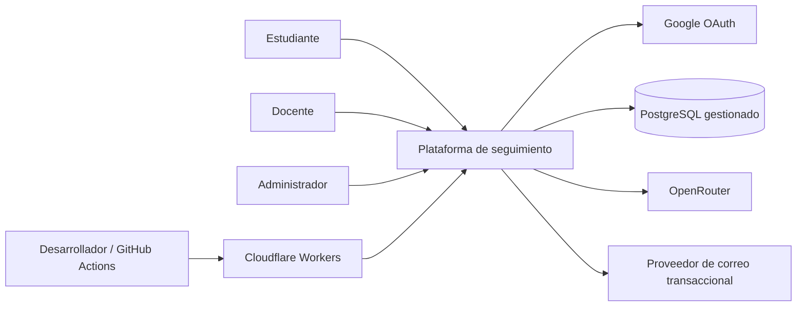
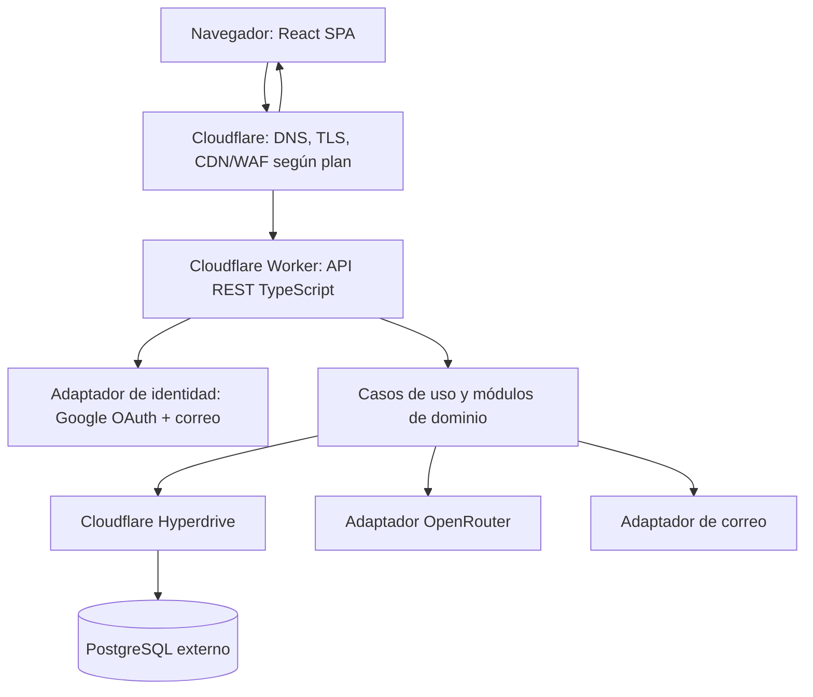

# 3. Arquitectura de software

## 3.1 Decisión principal

**Monolito modular con arquitectura hexagonal/Clean Architecture**, desplegado inicialmente como una aplicación web sobre Cloudflare Workers/Static Assets. El sistema tendrá una API REST versionada y una única base de datos PostgreSQL. No se adoptan microservicios en la primera versión.

### ¿Por qué no microservicios?

El alcance académico requiere demostrar módulos, contratos, pruebas, seguridad, despliegue y escalabilidad, pero no justifica desde el inicio despliegues, observabilidad, redes y consistencia distribuida entre múltiples servicios. Los límites modulares permitirán extraer un servicio solo cuando existan métricas y una razón de negocio.

## 3.2 Stack de referencia

| Área | Elección propuesta | Motivo |
|---|---|---|
| Frontend | React + TypeScript + Vite | Ecosistema amplio, tipado y buen soporte para UI compleja. |
| UI | Tailwind CSS + shadcn/ui + Radix UI + Lucide | Componentes accesibles y editables dentro del repositorio. |
| Drag and drop | dnd-kit | Tableros Kanban accesibles y personalizables. |
| Estado remoto | TanStack Query | Caché, invalidación y sincronización de datos de API. |
| Formularios | React Hook Form + Zod | Validación consistente de formularios. |
| API | TypeScript sobre Cloudflare Workers | Despliegue nativo en el destino elegido. |
| Validación de contratos | Zod y generación/validación OpenAPI | Tipos y contrato coherentes. |
| ORM/migraciones | Drizzle ORM (sujeto a spike de compatibilidad) | Esquema tipado y migraciones SQL. |
| Persistencia | PostgreSQL gestionado (Neon como candidato inicial) | Relacional, transaccional y portable. |
| Acceso DB | Cloudflare Hyperdrive | Pool de conexiones y optimización de conexiones desde Workers. |
| Autenticación | Biblioteca compatible con Workers (Better Auth como candidato para spike) | Evitar implementar OAuth/password desde cero. |
| IA | `AIProvider` + adaptador OpenRouter | Evitar acoplar casos de uso a un proveedor. |
| Pruebas | Vitest, integración con DB de prueba, Playwright, k6 | Pirámide de pruebas y carga. |
| CI/CD | GitHub Actions + Wrangler | Validaciones en PR y despliegue reproducible. |

Las versiones exactas se fijarán en los archivos de dependencias y lockfile. Antes de elegir definitivamente ORM/autenticación se hará una prueba de compatibilidad real con Workers, Hyperdrive y PostgreSQL.

## 3.3 Alternativa evaluada: FastAPI/Python Workers

Cloudflare documenta soporte de FastAPI en Python Workers, por lo que no es una opción inválida. Sin embargo, el soporte de paquetes Python en Workers tiene diferencias respecto a un servidor Python convencional y algunos paquetes pueden no estar disponibles. Para un producto centrado en Cloudflare y con presupuesto reducido, se prefiere TypeScript nativo en el primer diseño. Si la prueba de compatibilidad demuestra un beneficio claro de FastAPI o un requisito académico explícito, se puede revisar la decisión mediante ADR.

## 3.4 Vista de contexto C4

## 3.5 Vista de contenedores C4

## 3.6 Capas hexagonales

- **Dominio:** entidades, reglas invariantes y tipos de valor. No conoce React, Workers, PostgreSQL ni OpenRouter.
- **Aplicación:** casos de uso y coordinación de transacciones; depende de interfaces/puertos.
- **Puertos:** `ProjectRepository`, `TaskRepository`, `IdentityProvider`, `AIProvider`, `NotificationSender`, `Clock`, `AuditWriter`.
- **Adaptadores de entrada:** endpoints HTTP, validación de request, autenticación y autorización.
- **Adaptadores de salida:** PostgreSQL/Drizzle, Google OAuth, correo, OpenRouter y logging.
- **Composición:** configuración de Workers conecta implementaciones concretas a puertos.

## 3.7 Módulos de dominio

1. Identity & Access: cuentas, perfiles, roles, sesiones y políticas.
2. Academic Structure: cursos, periodos y asignaciones docentes (solo los necesarios para el proyecto).
3. Projects & Teams: proyectos, membresías y roles dentro del proyecto.
4. Boards & Tasks: tableros, columnas, tarjetas/tareas, etiquetas y orden.
5. Collaboration: comentarios, actividad y avances.
6. Deliverables & Reviews: metadatos de entregables y revisión docente.
7. Notifications: notificaciones internas y generación de eventos.
8. Audit: historial de operaciones relevantes.
9. Reporting: consultas agregadas y vistas de progreso.
10. AI Assistant: resumen, riesgos potenciales y sugerencias mediante `AIProvider`.

Los módulos pueden compartir una base PostgreSQL, pero no deben leer/escribir arbitrariamente tablas de otros módulos desde cualquier capa. Las dependencias entre módulos deben pasar por interfaces/casos de uso explícitos.

## 3.8 Datos y persistencia

- PostgreSQL será la fuente de verdad.
- Todas las tablas principales tendrán claves primarias, restricciones de integridad y marcas temporales cuando aplique.
- Usar migraciones versionadas; nunca cambiar el esquema de producción manualmente sin migración reproducible.
- Aplicar paginación del lado del servidor, índices para filtros frecuentes y transacciones para movimientos de tareas/cambios de tablero.
- Hyperdrive gestiona conexiones desde Workers. No abrir conexiones ilimitadas ni conservar estado de sesión en memoria global del Worker.
- El caché de consultas de Hyperdrive no invalida automáticamente datos leídos después de escrituras; para rutas de consistencia inmediata usar consultas sin caché o una configuración apropiada.

## 3.9 Estrategia de caché

1. **Assets estáticos:** cacheo de recursos versionados de frontend mediante Cloudflare.
2. **API autenticada:** `Cache-Control: private, no-store` por defecto para datos privados. No cachear respuestas de usuarios/proyectos en CDN compartido.
3. **Datos públicos o configuración no sensible:** caché HTTP explícita solo tras revisar autorización e invalidación.
4. **TanStack Query:** caché en cliente con invalidación después de mutaciones; no sustituye autorización del servidor.
5. **Hyperdrive:** usar pooling; habilitar caché de consultas solo cuando la semántica de consistencia sea aceptable.
6. **Redis/KV:** no añadir al inicio. Evaluar después de medir cuellos de botella y definir invalidación/TTL.

## 3.10 Escalabilidad y límites

- Worker sin estado local y frontend distribuido por CDN.
- Consultas eficientes y paginadas, índices y límites de tamaño de payload.
- Límites de frecuencia para login, endpoints costosos e IA.
- Separación de ambientes de desarrollo, staging y producción.
- Medición antes de escalar planes o extraer servicios.
- Los límites gratuitos de Workers (por ejemplo, cuota diaria y tiempo de CPU) pueden cambiar; comprobarlos en el momento de desplegar y registrar la fecha en el informe. Las cargas de trabajo que excedan el nivel gratuito deben disparar una decisión explícita de costo, no un gasto inesperado.

## 3.11 Decisiones arquitectónicas (ADR)

- ADR-001: monolito modular + hexagonal.
- ADR-002: Cloudflare Workers + TypeScript como plataforma inicial.
- ADR-003: PostgreSQL + Hyperdrive.
- ADR-004: autenticación institucional con dos métodos.
- ADR-005: OpenRouter detrás de puerto `AIProvider`.
- ADR-006: archivos binarios fuera de la primera versión.
- ADR-007: estrategia de caché sin Redis inicial.

## 3.12 Documentación C4 pendiente de materializar gráficamente

Los diagramas Mermaid incluidos aquí son la fuente editable inicial. Para la sustentación, exportar los diagramas de contexto, contenedores y componentes a SVG/PNG o reconstruirlos en draw.io, manteniendo sincronía con la arquitectura real.
