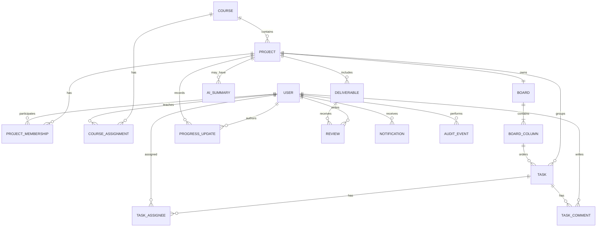

# 4. Modelo de dominio y datos

## 4.1 Modelo conceptual

## 4.2 Entidades iniciales

- `users`: id, email normalizado, nombre, estado, rol global si aplica, fechas.
- `auth_accounts` / `sessions`: según el modelo de la biblioteca de autenticación elegida; no almacenar contraseñas manualmente si el proveedor las gestiona.
- `courses`: código, nombre, periodo y estado.
- `course_assignments`: curso, docente y ámbito de responsabilidad.
- `projects`: título, descripción, curso, creador, responsable docente, estado, fechas.
- `project_memberships`: proyecto, usuario, rol en el proyecto, estado y fecha de incorporación.
- `boards`: proyecto, nombre y configuración visual.
- `board_columns`: tablero, nombre, orden, color opcional, categoría semántica y reglas de cierre.
- `tasks`: proyecto, columna, título, descripción, prioridad, orden, fechas, creador, fechas de modificación.
- `task_assignees`: relación muchos-a-muchos entre tarea y usuarios responsables.
- `labels` y `task_labels`: etiquetas de proyecto y asignaciones.
- `task_comments`: autor, tarea, contenido, fechas y estado de edición/eliminación lógica si se requiere.
- `progress_updates`: proyecto, autor, texto, porcentaje opcional no autoritativo y fecha.
- `deliverables`: proyecto, título, descripción, fecha límite, URL/metadatos, estado.
- `reviews`: entregable/avance, docente, observación, estado de revisión y fecha.
- `notifications`: destinatario, tipo, recurso, fecha de lectura y metadatos mínimos.
- `audit_events`: actor, acción, tipo/id de recurso, timestamp, correlation id y metadatos filtrados.
- `ai_usage_events`: usuario, proyecto, proveedor/modelo, tipo de operación, tokens/costo reportado si está disponible, estado y fecha; nunca guardar API keys.
- `ai_summaries` (opcional): proyecto, contenido resumido, fecha de generación y referencia a versión/fecha de datos utilizados.

## 4.3 Reglas de integridad

- Usar UUID como identificadores públicos para evitar exponer secuencias internas y facilitar portabilidad.
- `email` debe tener restricción única tras normalización.
- Una tarea debe pertenecer a un proyecto y una columna de ese mismo proyecto/tablero.
- Solo puede existir una membresía activa por par proyecto/usuario; las membresías retiradas se conservan como historial y una reincorporación crea un nuevo registro activo sin modificar los registros históricos.
- La asignación de usuarios a tareas debe validar que pertenecen al proyecto, salvo una regla explícita.
- Las transiciones de columna se validan en el servidor; el frontend no es autoridad.
- Las eliminaciones de cursos/proyectos con datos dependientes deben ser restringidas o lógicas según reglas documentadas.
- Fechas se almacenan en UTC; interfaz las presenta en la zona horaria del usuario.
- Índices iniciales: email; proyectos por curso/estado/updated_at; memberships por user_id/project_id; tasks por project_id/column_id/due_date; notifications por recipient_id/read_at; audit por resource_type/resource_id/created_at.

## 4.4 Transacciones

El movimiento de tarea debe validar permiso, columna destino y orden, persistir el cambio y generar el evento de actividad de manera consistente. Preferir una transacción SQL cuando ambas operaciones se escriben en la misma base de datos.

## 4.5 Evolución de esquema

Toda modificación se entrega con migración hacia adelante y estrategia de rollback cuando sea viable. Evitar migraciones destructivas en el mismo despliegue que código dependiente; usar expand/contract para cambios sensibles.

## 4.6 Archivos

Primera versión: almacenar URL, nombre, tipo declarado, autor y fecha como metadatos cuando corresponda. No almacenar archivos subidos en el filesystem del Worker. Si se aprueba carga binaria, diseñar un cambio OpenSpec separado para R2 u otro almacenamiento de objetos, validación de tipo/tamaño, autorización de descarga y políticas de retención.

## Persistencia Kanban local — migraciones 0003 y 0004

Implementada únicamente en `is488_dev`: `boards` (un tablero por proyecto), `board_columns` (orden por tablero), `tasks` (campos y orden), `task_assignees` (responsables y posición) y `task_activity` (append-only). FKs compuestas impiden columnas de otro proyecto; unicidad diferida permite reordenar en una transacción. El borrado interno de tareas es lógico para conservar referencias históricas; no se agrega un endpoint de eliminación. Las referencias históricas a columnas eliminadas no se borran en cascada.

0004 identifica cada entrada por `(task_id,position)`, preservando listas ordenadas con repeticiones ya admitidas por Maps, sin deduplicar silenciosamente. El filtro por responsable usa EXISTS y no multiplica tareas. SQL 0001–0003 y sus hashes permanecen intactos; las ocho tablas tuvieron el mismo hash de contenido antes/después de 0004.

Runtime carece de UPDATE/DELETE sobre actividad y de acceso al ledger. La validación de miembros/responsables y su retiro se coordinan con locks. El resultado transaccional se mantiene separado del transporte/cierre. Se comprobó conservación exacta tras reiniciar el entorno completo. Véase [guía local](development-local.md) y `evidence/kanban-postgresql/`.
